# 秘密调查档案馆
**现在是 v2.0.1：在 v2.0 界面重构的基础上，补齐了手机端的排版、返回与导航细节，并完善了守秘人审卡中心的说明。**

**一个给固定《克苏鲁的呼唤》跑团小组用的档案馆**——模组档案、带团履历、半自动车卡与角色卡审核，都收在同一个站点里。

## 它能帮你做什么

- **找模组**：按地区、人数、时长检索，支持合集归类与置顶。
- **半自动车卡**：掷骰、年龄补正、派生值自动计算，54 项技能与点数预算实时校验。
- **审卡**：KP 在「审卡中心」按规则清单核对角色卡，批量扫描后一键通过，驳回都留批复。
- **留履历**：逐场记录带团时长与在车调查员，自动汇总并导出长图。
- **出证书**：个人中心可生成结业证书长图，直接保存或打印。

> 访客无需登录即可浏览全部档案，也可以在本机免登录试车一张卡。

## 界面

明暗两套主题，同一套「深潜档案馆」视觉：

| 深海（默认） | 盐纸 |
| --- | --- |
| 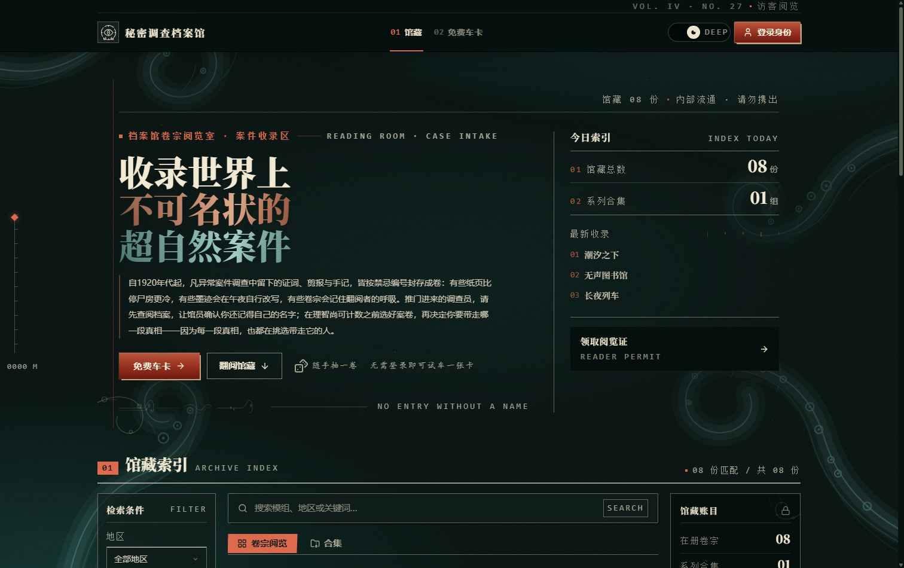 | 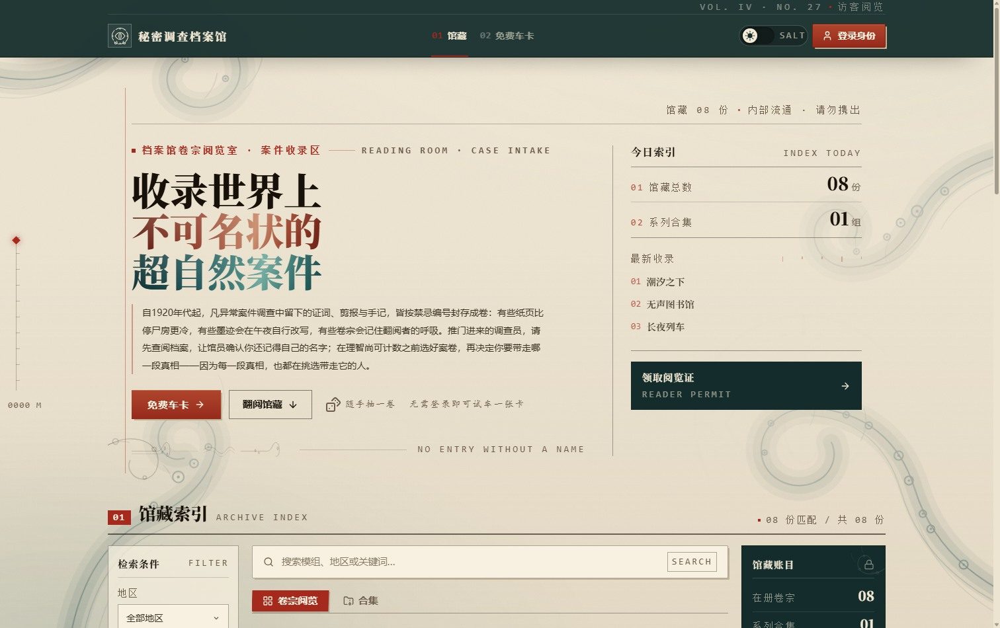 |

### 模组档案

每份卷宗记录时代、地区、人数、时长、规则与背景，附推荐职业和 KP 备注。打开详情可就地复制简介、标记「已调查」，或直接为它开一张角色卡。

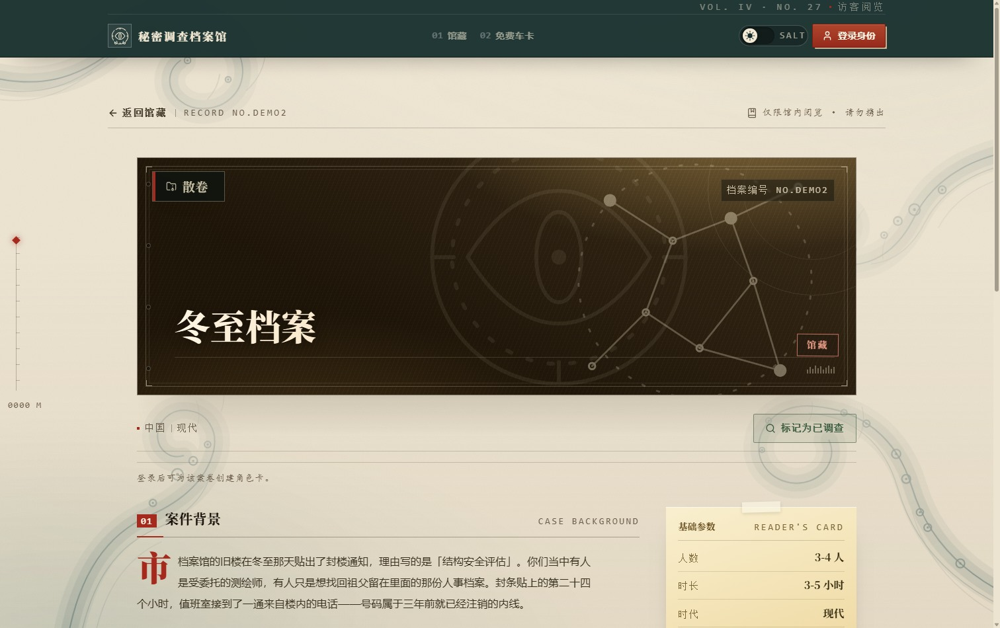

### 半自动车卡

「算得准的交给程序，拿主意的留给人」：属性掷骰、年龄补正、教育增强与 HP／理智／技能成功率等派生值自动完成，点数怎么分由你决定。

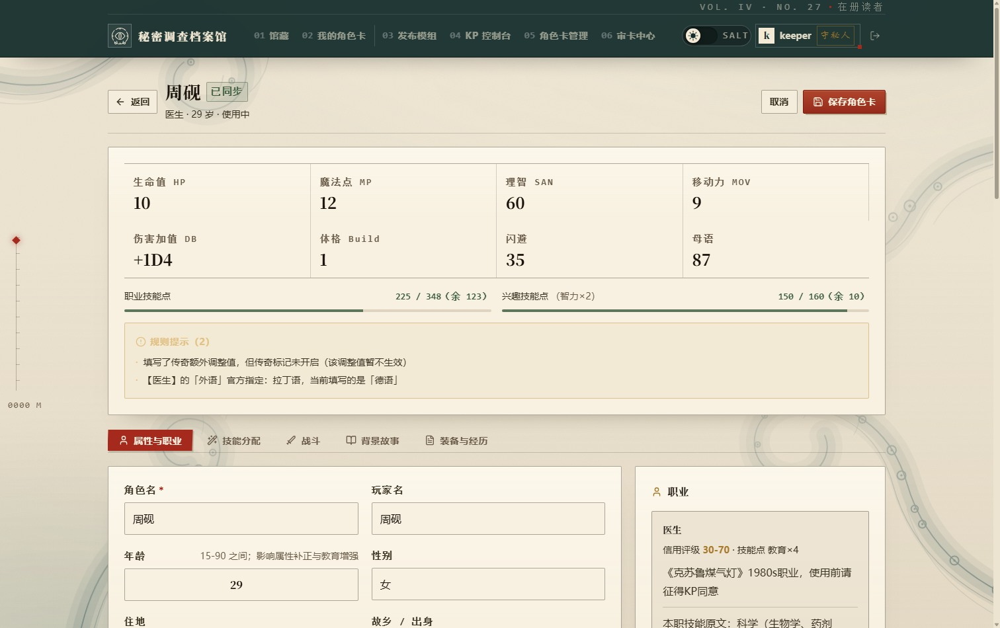

角色卡有独立的只读详情页，记录审核状态、KP 批复与模组经历：

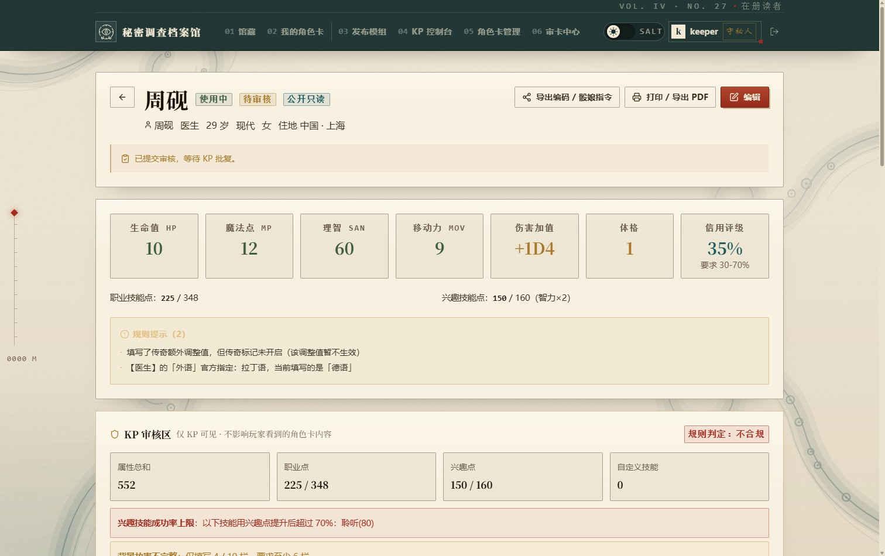

### 角色卡管理

KP 在「角色卡统一管理」里按玩家、状态与审核进度筛选全部角色卡，可以代建、代改、批量打印，也能从这里直接进审卡中心处理待审的卡。

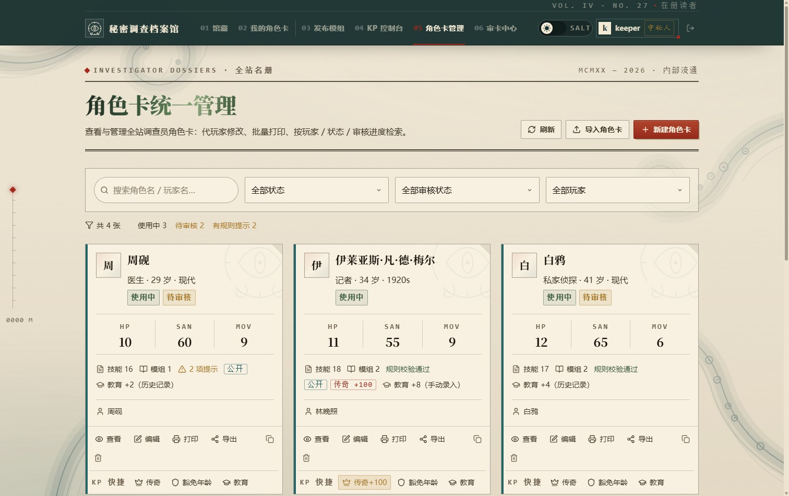

### 守秘人审卡中心

审卡中心是 KP 的审卡工作台，四张标签页各管一件事：

- **待审核队列**：玩家提交的卡按状态排队，点开就能看到按规则逐项核对的结果；通过或驳回都会留下批复，驳回的批复会回到玩家那边。
- **批量审卡**：按当前启用的规则一次性扫描一批卡（仅待审核 / 全部角色卡 / 指定玩家 / 手动勾选），先给出「总计 · 合规 · 不合规」统计，再把选中的卡一键标记为审核通过，适合开团前统一过一遍。
- **审卡规则**：把常见争议做成开关和阈值——属性有效值上下限与总和、职业/兴趣技能成功率上限、信用评级是否落在职业区间、禁止混点、必须选择职业、背景故事最低填写栏数、职业点最低使用率、自定义技能提示、职业专攻方向核对。默认全部关闭，按自己团的规矩启用。
- **职业模板**：维护自定义职业与本职技能，车卡和审卡共用同一套模板。

审核状态与批复属于档案记录，不会被打印进角色卡。

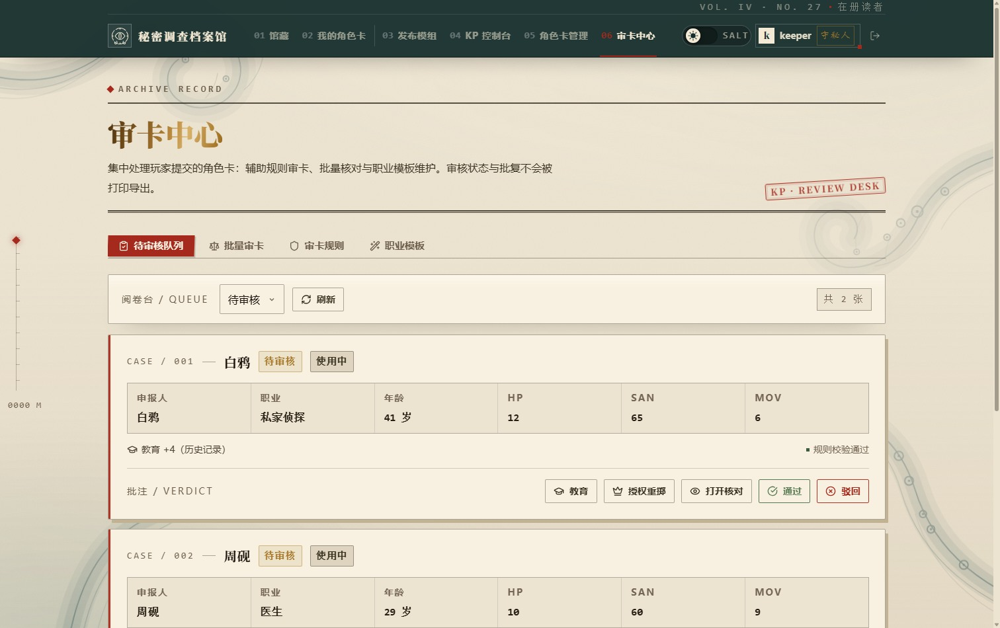

### 守秘人控制台

逐场记录带团日期、时长与在场调查员，实时汇总总场次与累计时长，并可导出履历长图。

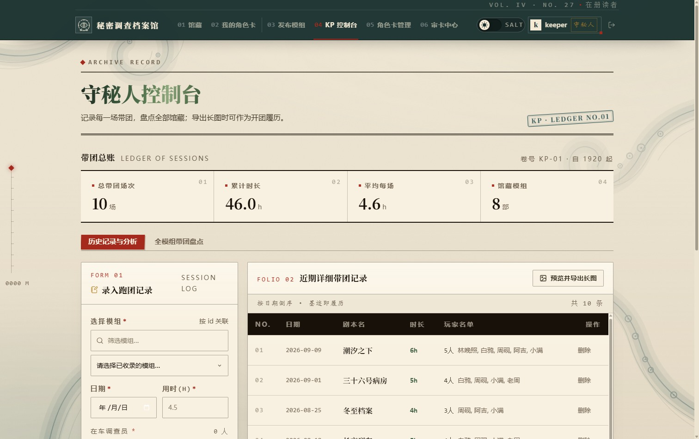

### 结业证书

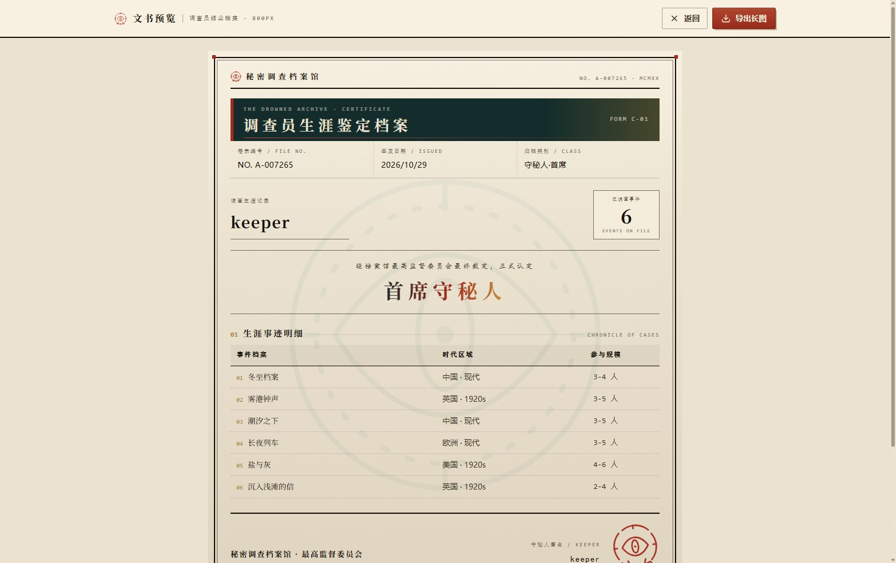

### 手机

同一站点在手机上自动排成单列，浏览档案、车卡与打印都能完成。

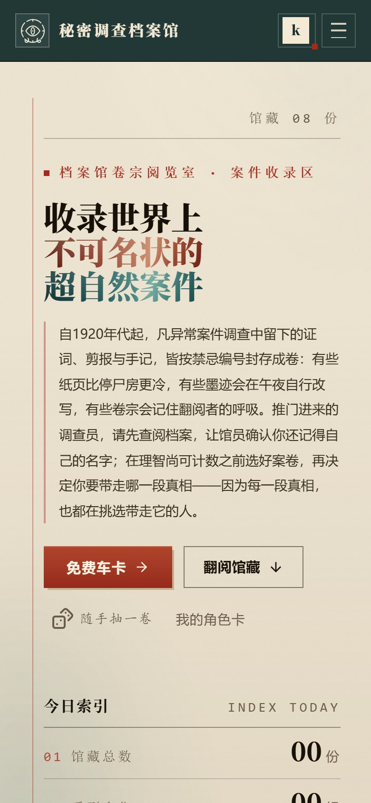

## 跑起来

需要 Node.js 20.19 以上（或 22.12 以上）。

```bash
git clone https://github.com/guinyd/coc-modules-archive.git
cd coc-modules-archive

npm install
npm --prefix backend install
npm run build

npm --prefix backend start     # 后端，默认 127.0.0.1:3000
npm run preview                # 另开一个终端；站点 http://localhost:4173
```

打开 <http://localhost:4173>，点「初始化首个账号」创建管理员。

**第一个注册的账号自动成为守秘人（KP）**；之后不再开放自助注册，账号由 KP 在「账号管理」里发放。

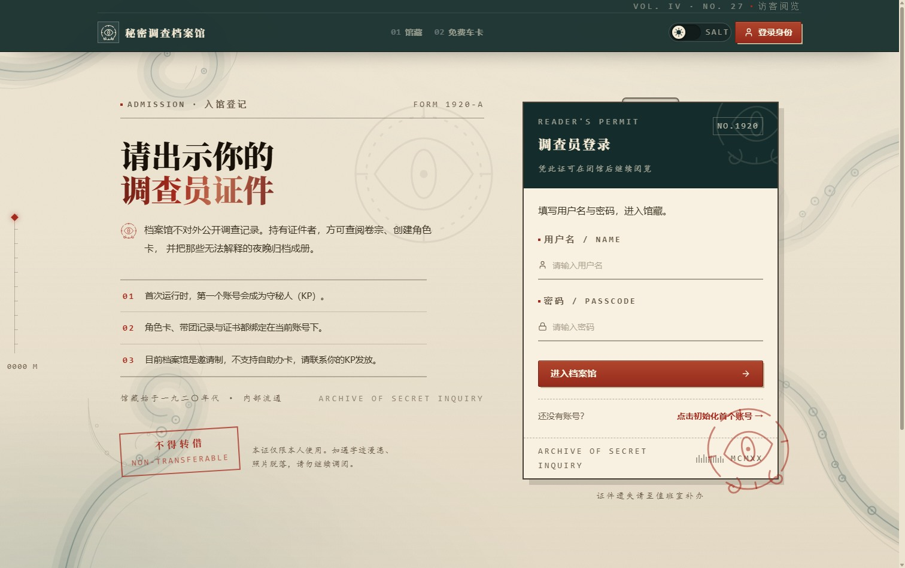

也可以一条命令启动：

```bash
bash run-local.sh start      # 后端 3000 + 站点 4173
bash run-local.sh status
bash run-local.sh stop
```

## 想先看看效果？

仓库自带一份虚构的演示数据（只在空库上写入，不会覆盖已有数据）：

```bash
node tools/seed-demo.mjs .demo-data
COCOC_DATA_DIR=.demo-data npm --prefix backend start
npm run preview
```

演示账号：

| 身份 | 账号 | 口令 |
| --- | --- | --- |
| 守秘人 | `keeper` | `Keeper-Demo-1920` |
| 调查员 | `林晚照` / `白鸦` / `周砚` | `Player-Demo-1920` |

数据都保存在自己的机器上（`backend/data/database.json`），删除这个目录即可清空。

## 许可

以 **MIT License** 发布，见 [LICENSE](LICENSE)。

《克苏鲁的呼唤》是 Chaosium Inc. 的注册商标；规则、职业与武器数据版权归 Chaosium Inc. 及其中文译者所有。本项目仅用于跑团辅助，不包含任何规则书正文，与 Chaosium 无隶属关系。

<sub>开发与部署细节见 [docs/DEVELOPMENT.md](docs/DEVELOPMENT.md)。</sub>
