# 秘密调查档案馆

**一个给固定《克苏鲁的呼唤》跑团小组用的档案馆**——模组档案、带团履历、半自动车卡与角色卡审核，都收在同一个站点里。

## 它能帮你做什么

- **找模组**：按地区、人数、时长检索，支持合集归类与置顶。
- **多版本车卡**：新建卡先选规则——**克苏鲁的呼唤 第七版（coc7th）** 或 **通俗克苏鲁（通克）**。七版走经典流程（掷骰/年龄补正/教育增强，54 项技能与两套点数池校验）；通克走英雄流程（22 个英雄原型、核心属性 (1D6+13)×5、四张天赋表、100 点英雄奖励白名单、68 个职业、58 项技能、HP=⌊(CON+SIZ)/5⌋）。两套规则各自独立：规则集、房规、职业模板、模组版本、打印栏目、Markdown 备份都分开存放，旧卡自动按七版读取。
- **审卡**：KP 在「审卡中心」按规则清单核对角色卡，批量扫描后一键通过，驳回都留批复。
- **留履历**：逐场记录带团时长与在车调查员，自动汇总并导出长图。
- **出证书**：个人中心可生成结业证书长图，直接保存或打印。
- **多守秘人协作**（v2.2.0）：一位首席守秘人 + 多位普通守秘人；守秘人只看到自己发放的账号、被玩家托管的角色卡、以及指定给自己的待审卡，审卡规则也能各自设定。
- **带团名册与书架**（v2.3.0）：守秘人可把任意模组加入自己的「带团列表」，档案目录新增「守密人名册」，按人筛出他能带的团；玩家可把角色卡同时托管给多位守秘人；个人中心的履历与带团列表都支持翻页。
- **规则集与房规**（v2.4.0）：审卡规则与房规合并成可切换的「规则集」——首席维护全局集，每位守秘人可保存多套个人集；角色卡新增「房规」页，选中后按该集重算技能基础值，送审时冻结。另含骰娘属性粘贴导入、审卡改为官方规则书基线。
- **角色卡备份**（v2.4.1）：角色卡可导出人读的 Markdown 档案（复制或下载 `.md`）与独立 `.json` 备份，导入支持 `.json`（及旧版带数据块的 `.md`）。技能表列出全部技能，属性总和标注「不含运 / 含运」；全站除法一律向下取整。
- **界面修订**（v2.4.3）：账号管理与守密人名册分页（账号 8 条/页、守秘人 4 人/页），账号表收窄后删除按钮不再需要横向滚动；记录人统一显示真实用户名；技能表改宽屏双栏、按分类同栏，空列加底衬线、专攻选择器内联；装备改为可增删的结构化清单（部位 + 物品），打印装备双栏并处理长文本。
- **成长与年龄豁免**（v2.6.0）：属性与理智可单独记「成长」；属性成长封顶 99、不计入职业/兴趣点预算，理智成长可负（上限 = 99 − 神话知识）；特长可直接按「格斗/射击/技艺/外语/科学」整组选取；年龄限 15–120，KP 勾选豁免后可录入更大年龄。
- **角色卡「附表」**（v2.6.1）：编辑器与详情页新增「附表」，记录法术（分类/消耗/用时/条件/详情/别名）与神话典籍（语言年代/理智损失/神秘学/神话/全文）；法术名旁「大典」按钮打开 471 条法术目录（17 分类、可搜索），点选自动补全；典籍可从 119 个版本条目中点选。附表随打印另起第三页，并写入 Markdown 与 .json 备份。
- **规则集详情与打印版面**（v2.5.5）：车卡「房规」页可展开查看规则集全部审卡阈值与自定义规则，支持按名称/发布人查找（6 套/页）；送审弹窗可搜索守秘人、列表改为滚动（8 位/页）；打印版面重做 HP/SAN/幸运/MP 可圈画记录区（Max/Start 胶囊 + 重伤/濒死/昏迷标记、01–99 数字格），装备区双栏，打印留白与屏幕一致。
- **多规则系统：通俗克苏鲁**（v3.0.0）：新建角色卡先选游戏规则——官方第七版，或《通俗克苏鲁》（Pulp Cthulhu）。通克车卡含 22 个英雄原型（核心属性 (1D6+13)×5、四张天赋表、部分原型强制天赋）、**英雄奖励点**（每原型固定 100 点，只能投原型技能，与职业点/兴趣点互不通用）、68 个通克职业、58 项技能（格斗/射击/灵能专攻，成功率可超过 100%）、HP = ⌊(体质+体型)/5⌋、初始幸运 (2D6+6)×5、七条幸运花费速查；审卡新增 7 条通克规则项，打印与 Markdown 档案按规则切换栏目。
- **规则隔离与版本标记**（v3.1.0）：审卡规则集、临时规则、职业模板、模组都可标注适用规则，两套规则各管各的——通克卡只看得到通克房规，跨规则选规则集直接拒绝。界面用语统一为 **coc7th / 通克 / 其它**；角色卡在玩家姓名右侧显示紫色规则简称，馆藏封面右下角显示版本标记，馆藏索引新增「版本」筛选。通克按规则书取消年龄补正与教育增强（年龄不再限 15–120）。
- **守秘人伴侣叠加层**（v3.2.0）：车卡可勾选「守秘人伴侣」扩展，在七版或通克卡上**叠加**一套伴侣房规——技能表换成伴侣修订版（84 项，社交合并为「说服」、神秘学可按专攻习得）、新增 25 个伴侣职业包与 8 栏背景、术语改为震骇/异变/永失；旧职业的技能自动路由到新表（社交技能并入固定本职「说服」，名额转成任选特长）。房规按规则集保存并由守秘人控制开关（推导技能基础值、兴趣点 EDU+INT、专精下限、职业包可搬点、第二母语、移动力 6 项可选）；另附伴侣专用打印版面（HP/MP/幸运/理智改为「最大/初始 + 当前」手写格、健康与理智同行、技能表下方一行四格战斗方格）。
- **骰娘指令按规则取名**（v3.3.0）：导出骰娘指令时改用当前游戏规则的技能表——伴侣层卡导出「自然学 / 说服 / 安抚」，旧叫法（博物学 / 取悦 / 话术）自动降为别名，跨规则表互认同义名；单槽专精（如伴侣版「宗教」）没填方向也按统称占位；技能别名一律只用中文，不再混入 charm / naturalWorld 这类英文名，连续英文 token 之间也补了空格，骰娘可直接切分。
- **自定义职业模板按规则分流**（v3.4.0）：守秘人发布的职业模板可标注适用规则（七版 / 通克 / 伴侣），车卡时只列出与当前卡规则相符的模板；勾选伴侣扩展后同时显示主体规则模板与伴侣职业模板（层是叠加，主体模板不再被隐藏）。模板的「任选特长」槽位在车卡校验中真正生效（此前会被裁成 0），伴侣模板最多 12 个特长槽、七版与通克模板最多 8 个。刚发布的模板不必刷新整页，进入车卡器即会重新拉取。
- **KP 工具箱**（v3.4.5）：KP 控制台新增「KP 工具箱」标签，两只都不落库的桌面工具——**带团状态记录卡**（自由勾字段模块：玩家/角色/性别/八项属性/HP/MP/SAN/幸运/重伤值/异变值…共 23 项，可加自定义字段；一人一张卡，A4 一页排 2/3/4 栏，勾选框直接打印涂抹）与**群战集群构建器**（按守秘人伴侣群战规则把一群杂兵折成单一实体：力量×2、体质/体型×5、生命 =(体质+体型)÷10、伤害加值取体格大一级、闪避 = 敏捷÷5、攻击×2，并给出满编/半残/濒散三档战力衰减）。两者都能在线直接改数与勾选、也可打印成 A4 或导出 .md；数据只存在浏览器本地，不上传服务器。
- **规则集真正生效**（v3.4.4）：修的是保存层——守秘人把审卡项改回 **0（不检查）** 时，此前会被判成「和官方默认一样、没改过」而丢弃，于是界面写 0、审卡仍按继承来的阈值报错（典型如「兴趣技能上限设 0 仍提示超过 60%」）。现在只要与继承层不同（哪怕等于官方默认 0）就会存下；审卡规则页显示的阈值也改为「全局基准 + 本套差异」的完整结果，界面数字＝审卡数字。审卡只按**玩家选的规则集**判定，不再掺入审卡人自己的私人规则；提交时冻结整套阈值，之后改全局基准也不影响已提交的卡。技能分配页的点数条改为贴在导航下方（此前被吸顶报头压住，看起来像没跟随），详情页与审卡阅览的「背景故事」页也显示「经历记录」。
- **房规生效、骰娘拆分与车卡细节**（v3.4.3）：守秘人把审卡项显式设成 0（职业技能上限、背景最少栏数 = 不检查）现在真的生效，不再被规则集基线顶回；背景栏数提示按当前规则的栏目数计（七版/通克 10 栏、伴侣层 8 栏）。骰娘指令里「统称+专攻」不再拼成 `母语法语`，改为 `母语80 法语80 拉丁语80`、`宗教50 神学50 天主教50`、`神秘学37 炼金术37`；技能分配页的点数条下滚吸顶；「经历记录」移到背景故事页最下方（关联模组与打印版面不变）；详情页与审卡阅览能看到 `+N 奖励` 与「英雄奖励点 已用 / 100」；通克审卡新增「核心属性下限」（默认 0 不检查，自然下限 70）。
- **带分支技能可作任选特长**（v3.4.1）：职业的「任选 N 项其他特长」里可以整组选入带专攻的技能（艺术/手艺、格斗、射击、外语、科学、驾驶…），保存后不再丢失，分支照旧在技能分配里选。此前这类选择在保存时会被后端过滤掉，连带让该分支的职业点被审卡判成「非本职技能投入职业点」。
- **骰娘指令修正**（v2.4.2）：专攻技能不再输出「射击步枪/霰弹枪」「格斗斗殴」这类分支头，斜杠拆成独立技能名（步枪 / 霰弹枪 / 步霰、手枪、斗殴），骰娘可直接解析。

> 访客无需登录即可浏览全部档案，也可以在本机免登录试车一张卡。

## 界面

明暗两套主题，同一套「深潜档案馆」视觉：

| 深海（默认） | 盐纸 |
| --- | --- |
| 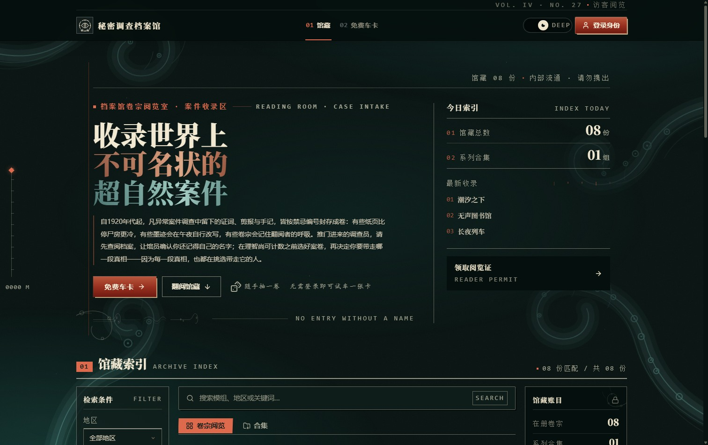 | 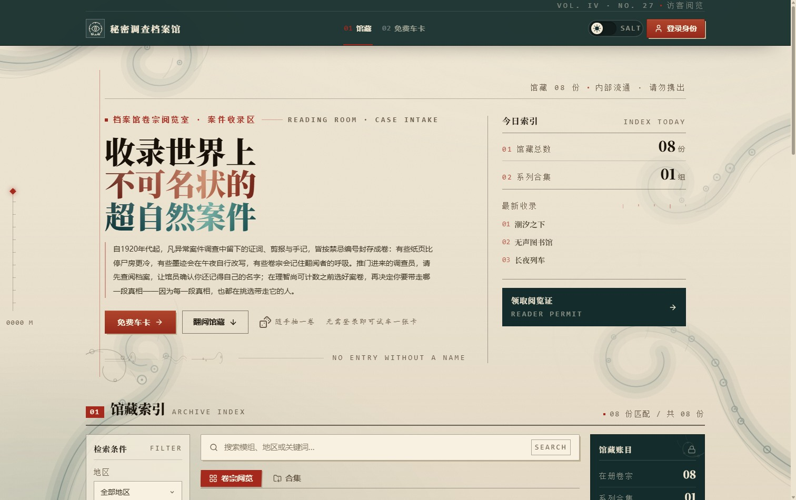 |

### 模组档案

每份卷宗记录时代、地区、人数、时长、规则与背景，附推荐职业和 KP 备注。打开详情可就地复制简介、标记「已调查」，或直接为它开一张角色卡。

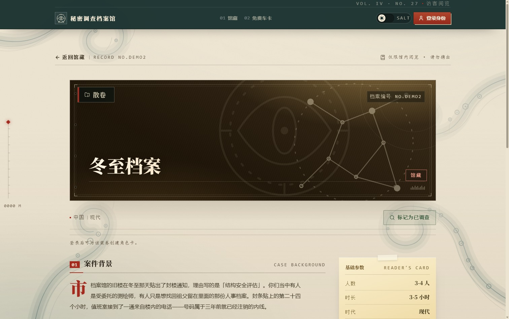

### 半自动车卡

「算得准的交给程序，拿主意的留给人」：属性掷骰、年龄补正、教育增强与 HP／理智／技能成功率等派生值自动完成，点数怎么分由你决定。

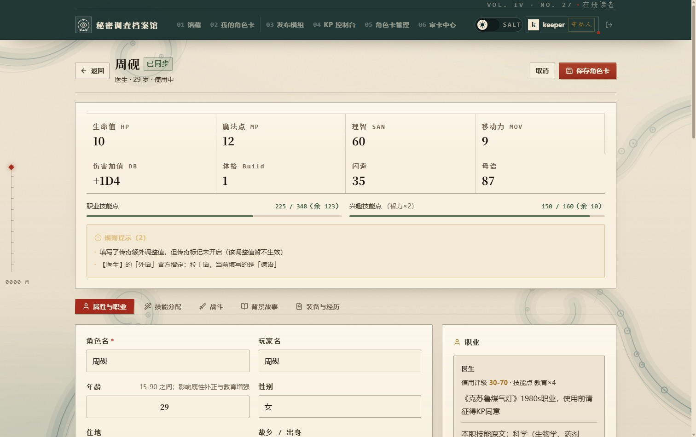

角色卡有独立的只读详情页，记录审核状态、KP 批复与模组经历：

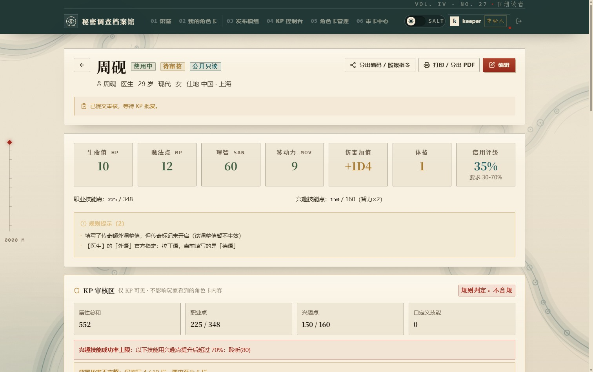

### 角色卡管理

首席守秘人可以在「角色卡统一管理」里按玩家、状态与审核进度筛选全部角色卡，代建、代改、批量打印；普通守秘人只看到玩家**明确托管**给自己的卡，且只能调整传奇、年龄豁免与教育增强。

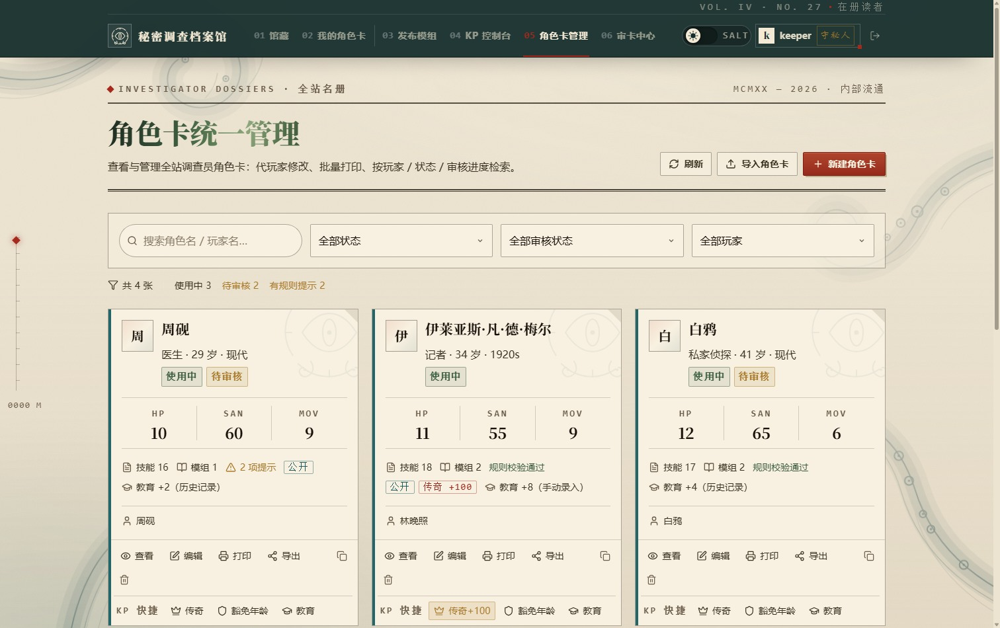

### 守秘人审卡中心

审卡中心是 KP 的审卡工作台，四张标签页各管一件事：

- **待审核队列**：只显示**玩家指定给你**的卡（首席可见全站）；点开就能看到按规则逐项核对的结果；通过或驳回都会留下批复，驳回的批复会回到玩家那边。
- **批量审卡**：按当前启用的规则一次性扫描一批卡（仅待审核 / 全部角色卡 / 指定玩家 / 手动勾选），先给出「总计 · 合规 · 不合规」统计，再把选中的卡一键标记为审核通过，适合开团前统一过一遍。
- **审卡规则**：默认取**官方规则书基线**（属性 15–90、智力/体型 ≥40、技能无上限、允许混点），再按自己团的规矩开启更严格的检查项——属性总和、职业/兴趣技能上限、信用评级区间、禁混点与信用评级仅职业点、背景最低栏数、职业点使用率等。规则与房规同属「规则集」：首席维护全局集，其他守秘人可保存多套个人集并随时切换；审卡时按卡上冻结的规则复核。
- **职业模板**：维护自定义职业与本职技能，车卡和审卡共用同一套模板。

审核状态与批复属于档案记录，不会被打印进角色卡。

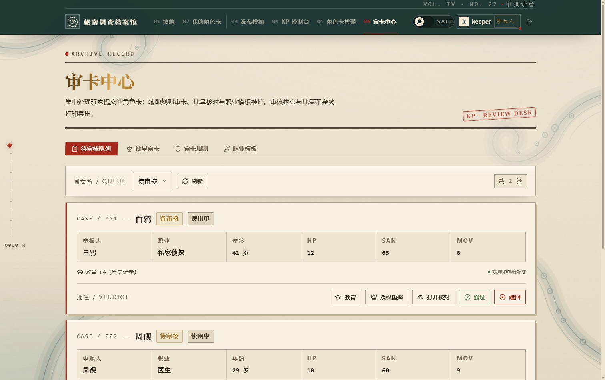

### 规则集与房规（v2.4.0）

「审卡规则」和「房规」合并成一套可切换的**规则集**：首席维护全局集，每位守秘人可保存多套个人集，一键「设为当前」；玩家车卡时在「房规」页选用，技能基础值按这套规则重算，送审时冻结当时的规则。

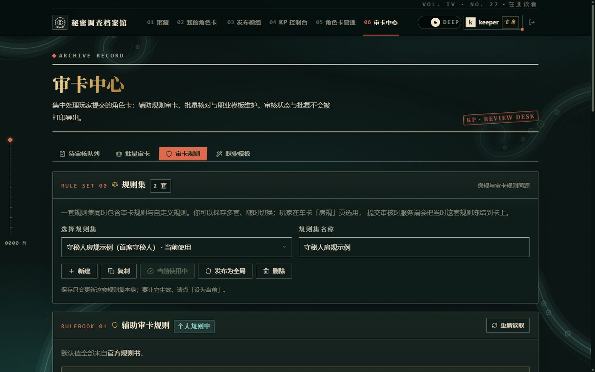

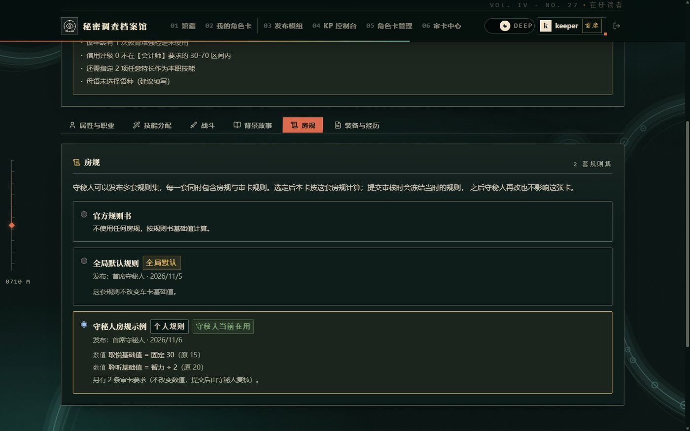

### KP 工具箱（v3.4.5）

KP 控制台的第一个标签，两张「不落库」的桌面工具：数据只留在你自己的浏览器里（localStorage 草稿），不上传服务器、不占账号额度——离线前打印或导出 .md 留档即可。

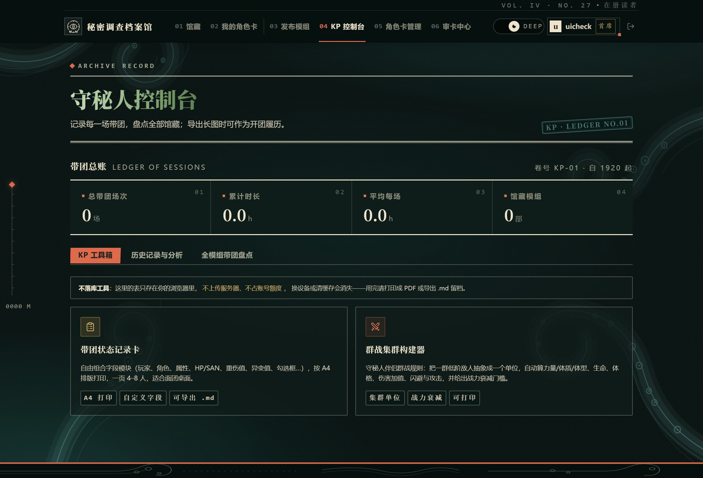

**带团状态记录卡**：按需勾选字段模块（玩家、角色、性别、八项属性、HP／MP／SAN／幸运、重伤值、异变值、伤害加值…共 23 项），能加只属于这一桌的自定义字段；一人一张卡，A4 一页排 2／3／4 栏（默认 2 栏，4–8 人刚好）。「桌面模式」可以一边带团一边直接改数值、点选重伤／昏迷／濒死／震骇／异变／临时疯狂，用不着打印也能当电子记录表；切到「A4 预览」就是打印版面，勾选框用 ☑／☐，印出来直接涂画。

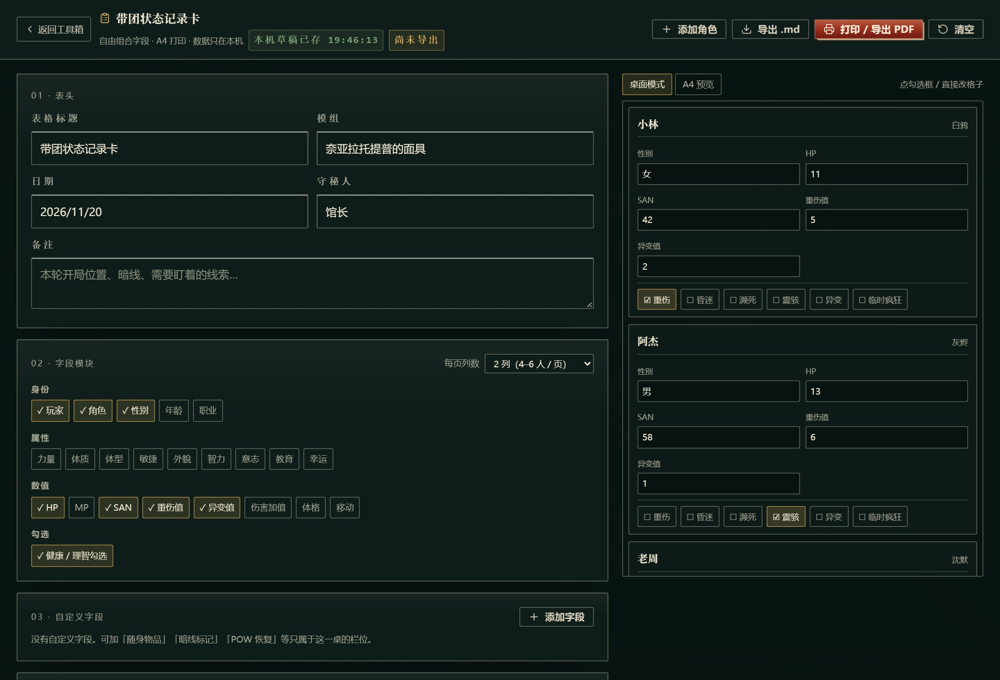

**群战集群构建器**：把一群杂兵折成单一实体——力量 ×2、体质与体型 ×5、生命 =（体质+体型）÷10、体格查表、伤害加值取「体格大一级」、闪避 = 敏捷 ÷5、攻击技能 ×2；同时给出满编（每回合 3 次）／半残（2 次 + 惩罚骰）／濒散（1 次）三档战力衰减。顶栏「添加集群」可并列多组敌人，每个集群可挂多条攻击技能（格斗、刀、斧头、擒拿…），扣血时阶段与生命条实时联动，打印时按集群分块、一页能排几张排几张。

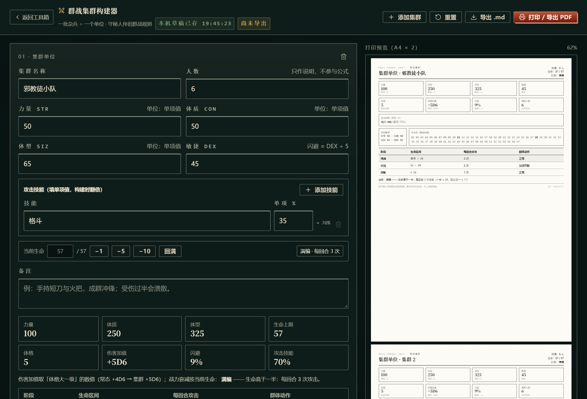

### 守秘人控制台

逐场记录带团日期、时长与在场调查员，实时汇总总场次与累计时长，并可导出履历长图。

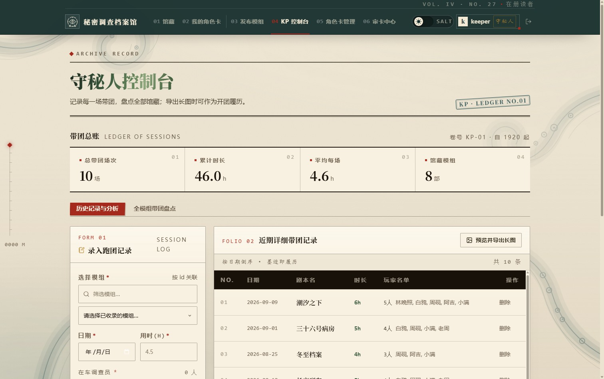

### 结业证书

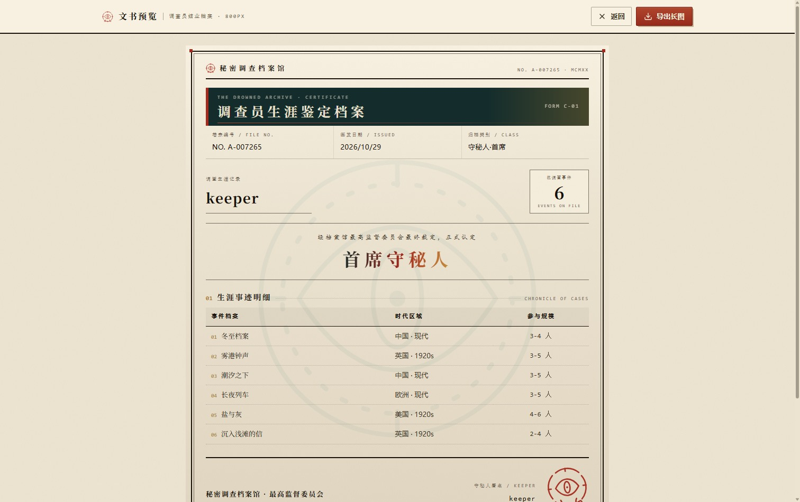

### 手机

同一站点在手机上自动排成单列，浏览档案、车卡与打印都能完成。

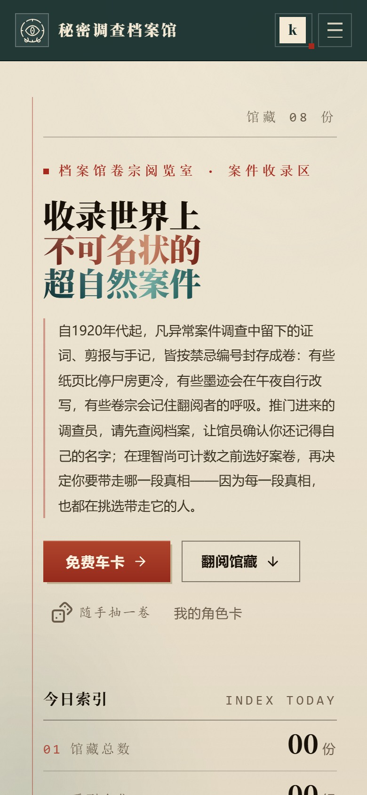

## 跑起来

需要 Node.js 20.19 以上（或 22.12 以上）。

```bash
git clone https://github.com/guinyd/coc-modules-archive.git
cd coc-modules-archive

npm install
npm --prefix backend install
npm run build

npm --prefix backend start     # 后端，默认 127.0.0.1:3000
npm run preview                # 另开一个终端；站点 http://localhost:4173
```

打开 <http://localhost:4173>，点「初始化首个账号」创建**首席守秘人**。

**第一个注册的账号自动成为首席守秘人（首席 KP）**；之后不再开放自助注册，账号由守秘人在「账号管理」里发放。首席可以任命其他守秘人、调整称号或移交首席身份；普通守秘人只能发放玩家账号，看不到别人的名册。

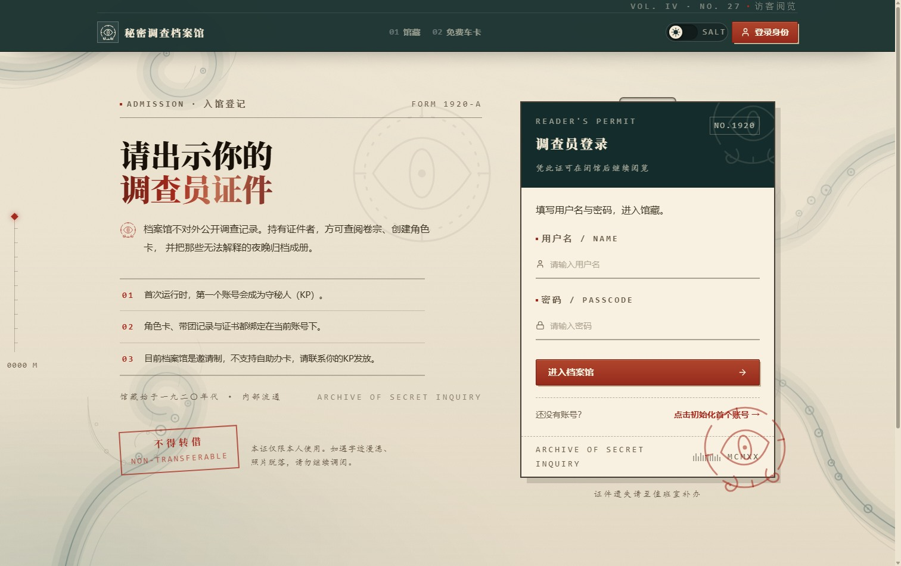

也可以一条命令启动：

```bash
bash run-local.sh start      # 后端 3000 + 站点 4173
bash run-local.sh status
bash run-local.sh stop
```

## 想先看看效果？

仓库自带一份虚构的演示数据（只在空库上写入，不会覆盖已有数据）：

```bash
node tools/seed-demo.mjs .demo-data
COCOC_DATA_DIR=.demo-data npm --prefix backend start
npm run preview
```

演示账号：

| 身份 | 账号 | 口令 |
| --- | --- | --- |
| 守秘人 | `keeper` | `Keeper-Demo-1920` |
| 调查员 | `林晚照` / `白鸦` / `周砚` | `Player-Demo-1920` |

数据都保存在自己的机器上（`backend/data/database.json`），删除这个目录即可清空。

## 版本

当前 **v3.4.5**：KP 控制台新增「KP 工具箱」，两件不落库的桌面工具——**带团状态记录卡**（23 项字段模块自由勾选 + 自定义字段，A4 一页 2/3/4 栏，桌面模式可直接改数点勾选，可打印与导出 .md）与**群战集群构建器**（守秘人伴侣群战规则：属性放大、生命合成、伤害加值大一级、闪避、攻击 ×2，三档战力衰减；支持多集群并列与自定义攻击技能，扣血实时联动，A4 同页打印）。两者都只写浏览器本地草稿，服务端零改动。这一版基于开发的 v10.14.3，同时带来三处版式修正：A4 预览自动缩放（不再 100% 溢出）、打印先撤掉应用骨架（不再先吐一张空白页）、打印宽度按可打印区收紧（右侧不再被切）。v3.4.4 的规则集真正生效、v3.4.3 的房规 0 生效与骰娘拆分、v3.4.2 的背景故事按规则集显示、v3.4.1 的「带分支技能组可作任选特长」、v3.4.0 的模板按规则分流与伴侣层模板并集、v3.3.0 的骰娘指令按规则取名、v3.2.0 的守秘人伴侣叠加层、v3.1.0 的规则隔离、v3.0.0 的两套规则车卡全部保留，官方七版行为未变。更早版本见仓库 tag。

## 许可

以 **MIT License** 发布，见 [LICENSE](LICENSE)。

《克苏鲁的呼唤》是 Chaosium Inc. 的注册商标；规则、职业与武器数据版权归 Chaosium Inc. 及其中文译者所有。本项目仅用于跑团辅助，不包含任何规则书正文，与 Chaosium 无隶属关系。

